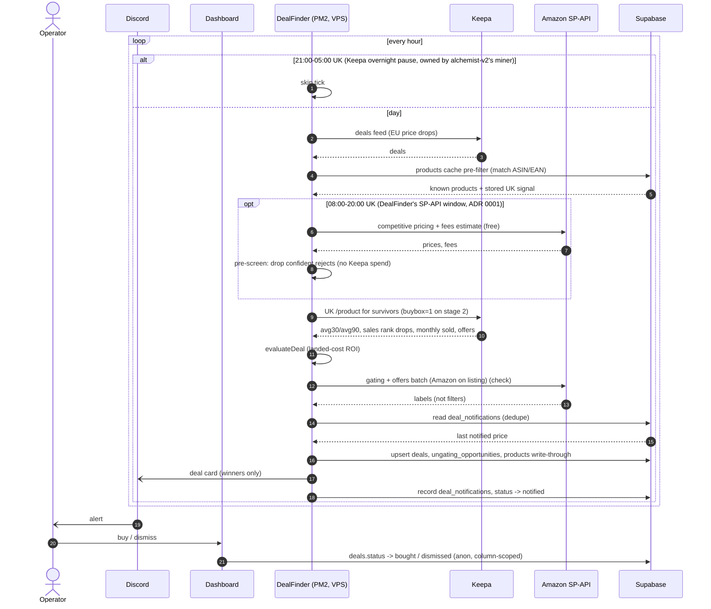
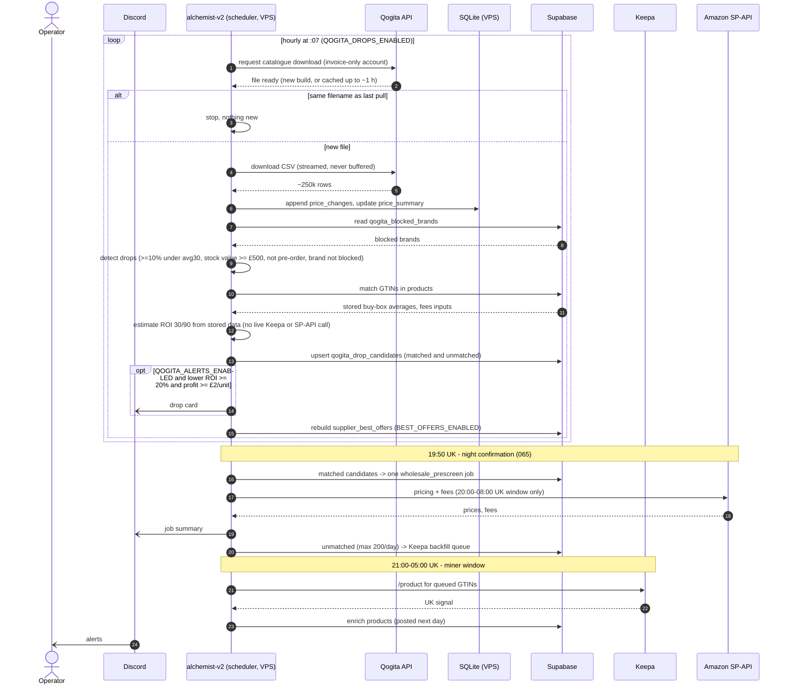
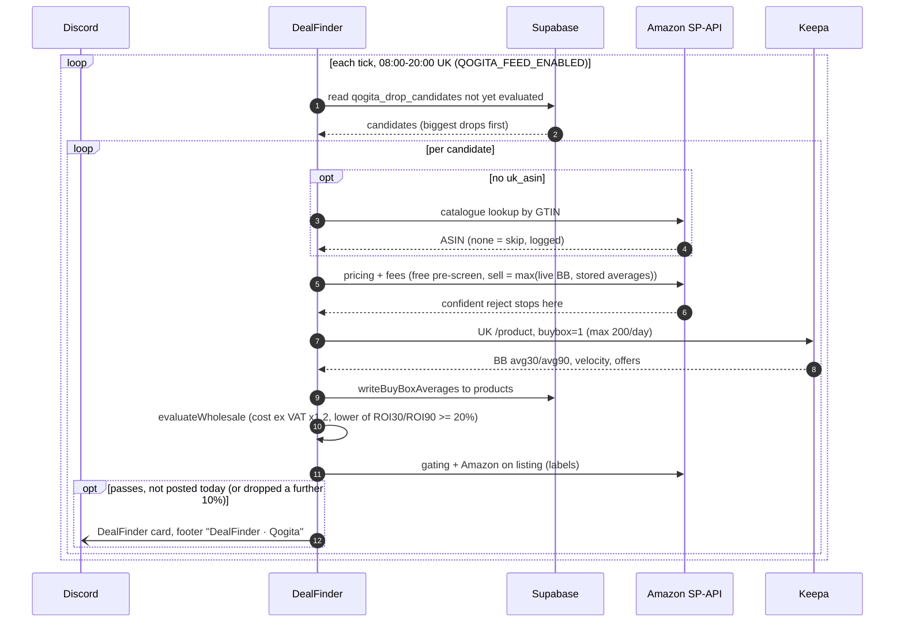

# Sequence views: DealFinder probe and Qogita drops

Text versions of the operator's hand-drawn sequence diagrams (2026-11-09), corrected against
`CONTRACTS.md` and the specs in `issues/`. GitHub renders the Mermaid blocks, so edit the text and
review the change in a PR like any other doc. The formal model behind them is
[`alchemist-suite.sysml`](alchemist-suite.sysml); see [README](README.md) for how the two relate.

Written from the coordination docs only. The DealFinder and alchemist-v2 code was not read, so steps
marked *(check)* need confirming in the owning repo.

Arrow key: `->>` call or message, `-->>` reply, `-)` async post (fire and forget).

## 1. DealFinder hourly probe (EU -> UK retail deals)

## 2. Qogita drops, as built (alchemist-v2 062-065, 069)

## 3. Qogita drops as a DealFinder feed (planned, DealFinder 067, dark)

`issues/in-progress/spec-qogita-dealfinder-feed.md`. This is the step the hand drawing puts on "Alchemist": the live
Keepa check of a drop. It belongs to DealFinder, in its day window, reading what alchemist-v2 wrote.

