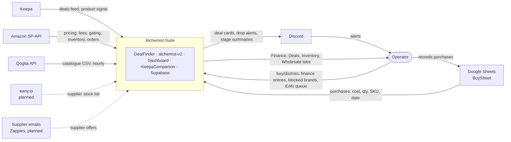
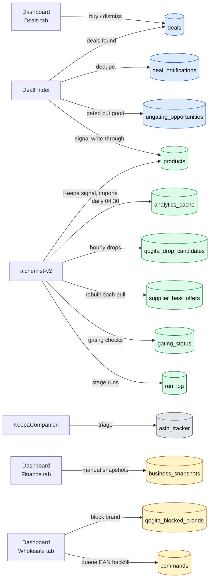
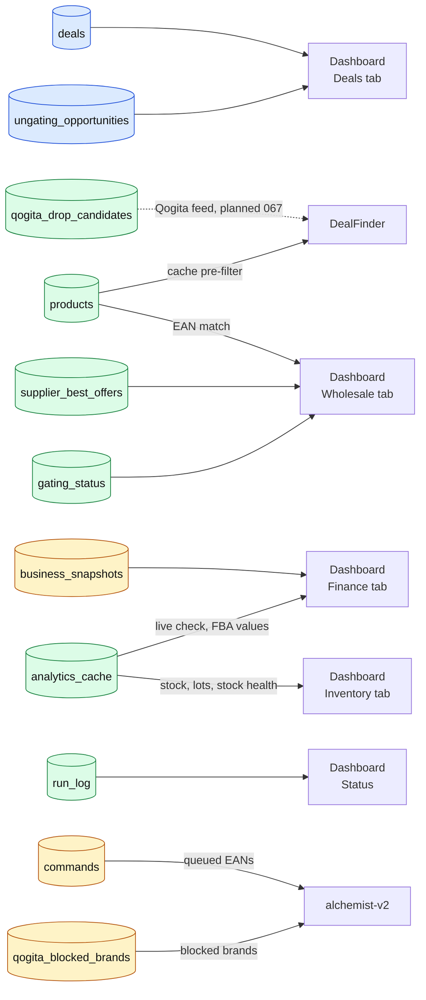
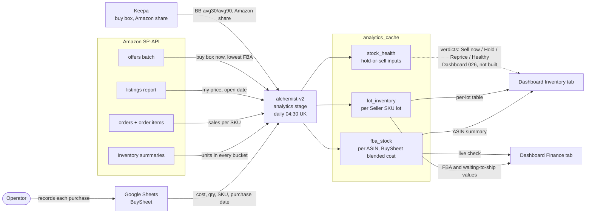

# Structure views: context, interconnection, inventory

Text versions of the operator's hand-drawn system diagram (2026-11-10), split into three views so each
stays readable. Built from `CONTRACTS.md` and `RUNLIST.md`, not the child repos' code. Same model as
[`alchemist-suite.sysml`](alchemist-suite.sysml); the sequence views are in [`sequences.md`](sequences.md).

Drawing rules: arrows point from writer to reader; every arrow says what flows; one level per view.

## The goal these views serve

**Track the business, and offer as many pre-filtered buy deals as possible, so the inventory keeps rolling.**

| Part of the goal | What delivers it |
|---|---|
| Track the business | Dashboard Finance tab (`business_snapshots`), Inventory tab (`analytics_cache`) |
| Pre-filtered buy deals | DealFinder (EU/UK retail deals), Qogita drops (alchemist-v2, DealFinder feed planned), supplier best offers (Wholesale tab), wholesale pre-screen |
| Keep the inventory rolling | Inventory tab per-lot table; hold-or-sell verdicts (R51, in progress) |

## 1. Context view: the suite and the outside world

The whole suite is one box. Everything outside it is something it talks to.

## 2. Interconnection view: inside the suite

Supabase is the hub: the apps almost never talk to each other directly, they meet in tables. Drawn as two
diagrams, writes then reads, because one diagram with both is the tangle the hand drawing ran into.
Table colour = owning repo (CONTRACTS.md section 2): blue DealFinder, green alchemist-v2, amber Dashboard,
grey KeepaCompanion. Discord and external APIs are in view 1.

### 2a. Who writes what

### 2b. Who reads what

## 3. Inventory: how the Inventory tab is fed

There is no separate inventory manager. The Inventory tab reads `analytics_cache`, written once a day by
alchemist-v2's `analytics` stage.

Status per RUNLIST R51 (last note 2026-10-30): the `stock_health` column is applied live; the operator
still has to set `SP_API_SELLER_ID` and deploy alchemist-v2, then Dashboard 026 builds the verdict table.
Stock at a 3PL or prep centre before it ships to Amazon is invisible to SP-API and is not estimated.

## Differences from the hand drawing

- **"Inventory mgr" is not an app.** It is the alchemist-v2 `analytics` stage. "Sheets" is the BuySheet.
- **The Inventory tab does not write anything.** It only reads `analytics_cache`. The Finance tab is
  the only one that writes your own numbers (`business_snapshots`).
- **Alchemist is missing most of its links:** Qogita, Keepa (overnight miner and inventory), SP-API
  (night pre-screen, gating, inventory, orders), Google Sheets and Discord.
- **Email** goes to DealFinder (Zappies, not built). **eany.io** goes to alchemist-v2 (R55, not built).
- **Keepa's two boxes** are right: the deals feed (DealFinder) and product data (both apps).
- The Dashboard's Wholesale tab reads `supplier_best_offers` and `products`, and writes the EAN queue
  and blocked brands.
