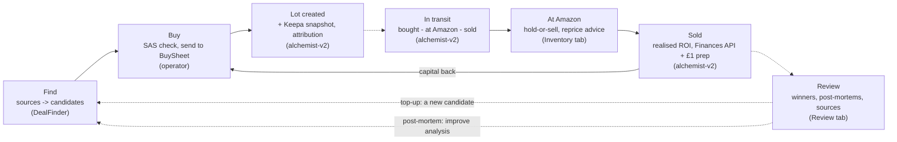
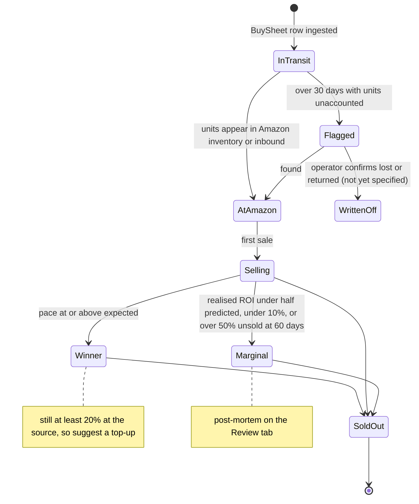
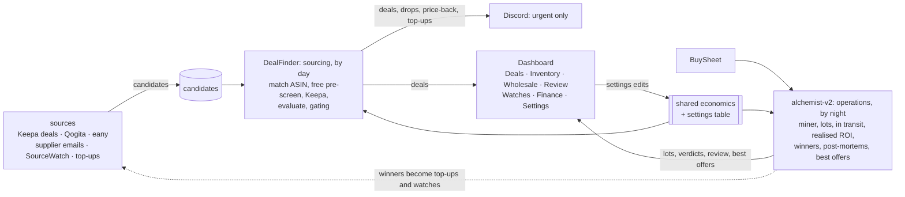

# Target design: the business loop and the sourcing/operations split

Where the constellation is heading, from the 2026-11-10 grill (`issues/spec-business-loop.md`, ADRs 0002-0005).
Today's design is in [`structure.md`](structure.md). Dashed lines are not built yet.

## 1. The capital cycle

The loop the whole suite serves. Each step names who owns it; the dashed steps are the gaps the grill closes.

## 2. Lot states

## 3. Sourcing and operations

Every source writes candidates; DealFinder evaluates all of them with the shared economics and settings.
alchemist-v2 runs operations. Discord gets only urgent, perishable actions (ADR 0005).

